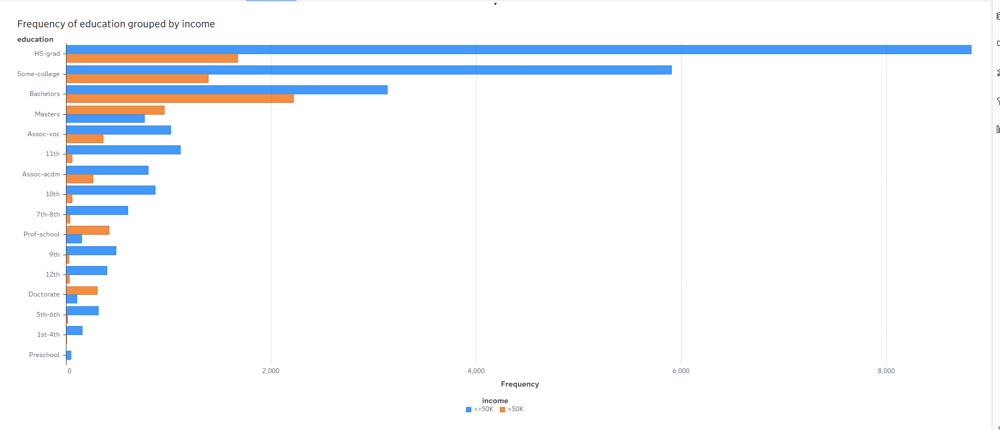
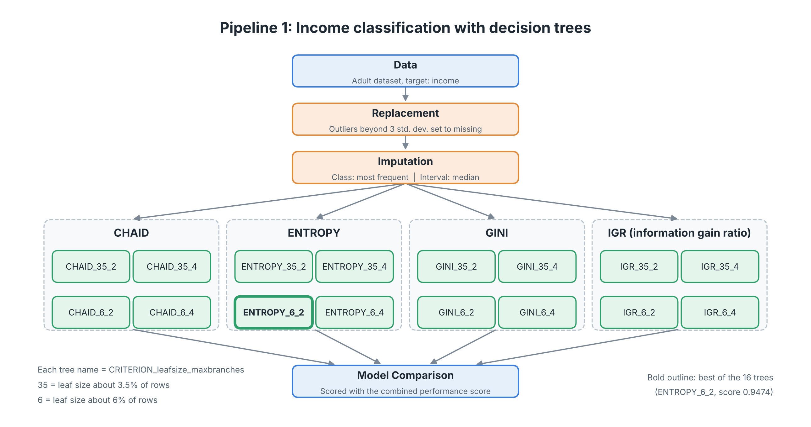
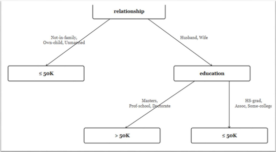
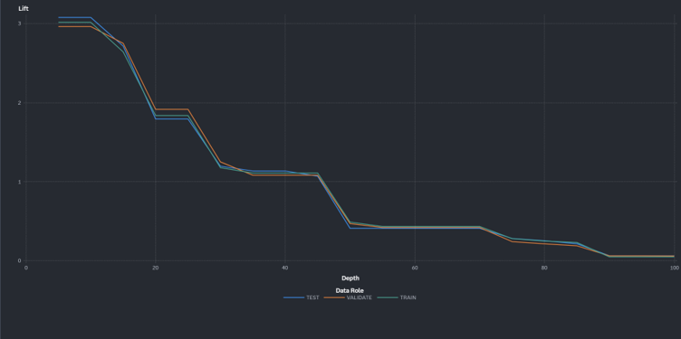

# Adult Census Income: Classification and Segmentation in SAS Viya

A data mining project that predicts whether a person earns more than $50K a year, using decision trees, and segments the same population with k-means clustering. Everything was built in **SAS Viya Model Studio** on the UCI Adult Census Income dataset.

## Team

- Hashem Alharthi
- [Omar Arif](https://github.com/Omar-Arif-Projects)
- [Abubakr Alattas](https://github.com/AbubakrAlattas)
- [Faris Alharbi](https://github.com/FaresAlharbi21)

## Project at a glance

| | |
|---|---|
| **Goal** | Predict `income` (`<=50K` or `>50K`) and find the factors that drive it |
| **Dataset** | [UCI Adult Census Income](https://archive.ics.uci.edu/dataset/2/adult), 32,561 records |
| **Tool** | SAS Viya Model Studio |
| **Methods** | Decision trees (CHAID, Entropy, Gini, IGR), k-means clustering |
| **Best accuracy** | About 0.82 to 0.83 |

## Problem

Knowing which factors influence earning potential helps with economic planning and targeted support programs. The goal here is to classify individuals by income level using demographic and employment variables, and to see which of those variables matter most.

**Questions**
- How accurately can a decision tree classify people by income level?
- Which features matter most in separating people above and below $50K?
- Can data mining give a clearer picture of income distribution than traditional analysis?

**Hypotheses**
- **H1:** Higher education levels are associated with higher income.
- **H2:** People who work more hours per week are more likely to earn above $50K.
- **H3:** Certain occupations have a significant effect on income.
- **H4:** Marital status influences the likelihood of earning above $50K.

## Dataset

The dataset has 14 input variables and a binary target.

| Group | Variables |
|---|---|
| Demographic | `age`, `sex`, `race`, `marital_status`, `relationship`, `native_country` |
| Employment | `workclass`, `occupation`, `hours_per_week` |
| Education | `education`, `education_num` |
| Financial | `capital_gain`, `capital_loss`, `fnlwgt` |
| Target | `income` (`<=50K` / `>50K`) |

The raw data is not included in this repository. Download it from the [UCI page](https://archive.ics.uci.edu/dataset/2/adult).

**Class imbalance:** 24,720 records (75.9%) earn `<=50K` and 7,841 (24.1%) earn `>50K`.

## Data preparation

The preprocessing pipeline is Data, then Replacement, then Imputation.

- **Replacement:** interval outliers more than 3 standard deviations from the mean were replaced with missing values. Unknown class levels were also set to missing.
- **Imputation:** missing class values were filled with the most frequent level, and missing interval values with the median.
- **Rejected variable:** `native_country` was rejected because it has too many levels (42).

## Exploratory analysis: key findings

- **Education (H1 supported):** Bachelors, Masters, Doctorate and Prof-school holders have a much higher share of `>50K` earners. Lower education levels have almost none.
- **Occupation (H3 supported):** Exec-managerial and Prof-specialty have the strongest share of high earners. Other-service, Handlers-cleaners and Priv-house-serv have very few.
- **Marital status (H4 supported):** Married-civ-spouse accounts for by far the most `>50K` earners, around 6,500.
- **Age:** high earners are older. The median age is about 44 for `>50K` and 34 for `<=50K`.
- **Sex:** about 30.6% of males earn `>50K` compared to 10.9% of females in this dataset.
- **Hours per week:** most people work exactly 40 hours. This variable was not covered by a dedicated chart against income, so H2 is not directly confirmed by the exploratory analysis.
- **Capital gain and loss:** both are heavily zero-inflated with a few extreme outliers.
- **Correlations:** the numeric variables are only weakly correlated with each other, which suits tree-based models.



*Income level by education level. Higher degrees have a much larger share of `>50K` earners.*

## Modeling: decision trees



*Diagram of the classification pipeline in Model Studio.*

Sixteen trees were built by varying three settings:

| Setting | Values |
|---|---|
| Split criterion | CHAID, Entropy, Gini, IGR |
| Minimum leaf size | About 6% and 3.5% of the data |
| Maximum branches | 2 and 4 |

Each tree was scored with a combined performance score:

```
CPS = 0.60 x Accuracy + 0.05 x Simplicity + 0.20 x Lift + 0.15 x Stability
```

Accuracy has a threshold of 0.70, simplicity is based on the number of leaves, lift is measured at the 2nd decile, and stability checks that performance holds across the training, validation and test partitions.

### Top results

| Tree | Accuracy | Leaves | Lift (2nd decile) | Stable | Score |
|---|---|---|---|---|---|
| ENTROPY_4_2 | 0.8246 | 4 | 1.38 | Yes | 0.9498 |
| ENTROPY_6_2 | 0.82 | 4 | 1.38 | Yes | 0.9474 |
| IGR_35_4 / IGR_35_2 | 0.83 | 6 | 1.19 | Yes | 0.9398 |
| ENTROPY_35_2 / GINI_35_2 | 0.83 | 8 | 1.16 | Yes | 0.9338 |

Across all trees, accuracy ranged from 0.76 (CHAID) to 0.83. CHAID produced the simplest but least accurate trees. The full table of all 16 trees and every node setting is in [`pipelines/pipeline_summary.md`](pipelines/pipeline_summary.md).

### The best small tree

The ENTROPY_6_2 tree has only four leaves:

```
relationship
├── Not-in-family, Own-child, Unmarried  ->  <=50K
└── Husband, Wife
    └── education
        ├── Masters, Prof-school, Doctorate  ->  >50K
        └── HS-grad, Assoc, Some-college     ->  <=50K
```

Relationship status and education are the two variables that separate the classes best.





*The lift curves for the training, validation and test partitions follow each other closely, which shows the model is stable.*

## Segmentation: k-means

K-means was run with 2, 3, 4 and 5 clusters on the standardized numeric variables (Euclidean distance, Forgy initialization, seed 12345).

| Segmentation | Cluster sizes | Smallest cluster |
|---|---|---|
| km_2 | 16,930 / 15,631 | 15,631 |
| km_3 | 12,015 / 7,122 / 13,424 | 7,122 |
| km_4 | 1,261 / 12,634 / 6,888 / 11,778 | 1,261 |
| km_5 | 1,252 / 3,666 / 6,128 / 13,129 / 8,386 | 1,252 |

A cluster smaller than 10% of the data (about 3,300 records) was treated as an outlier cluster. Only km_4 and km_5 contain one.

To explain the km_3 clusters, four decision trees were fit with the cluster ID as the target. The best was an IGR tree (score 0.89), which used `relationship` and `education` as its main splits.

| Cluster | Age | Hours per week | Capital gain | Profile |
|---|---|---|---|---|
| Cluster_0 | Youngest | Fewest | Low | Low activity, low income |
| Cluster_1 | Middle | Average | Low | Moderate profile |
| Cluster_2 | Older | Most | Highest | High activity, higher income |

## Repository contents

| File | Description |
|---|---|
| [`pipelines/pipeline_summary.md`](pipelines/pipeline_summary.md) | Readable summary of both pipelines: every node, its settings, and the results tables |
| [`pipelines/Data_Mining.zip`](pipelines/Data_Mining.zip) | Model Studio project export |

## Reproducing the project

1. Download the dataset from [UCI](https://archive.ics.uci.edu/dataset/2/adult) and load it into SAS Viya as a table named `ADULT`.
2. In Model Studio, go to the Projects page and import `Data_Mining.zip`.
3. If the Data node reports a missing table, select your own `ADULT` table in the project's Data tab.
4. Run the `Pipeline 1` and `Clustering` pipelines.

The export was created from the project owner's account, so the import may only work from that account. `pipeline_summary.md` documents the settings either way.

## Limitations and next steps

- The classes are imbalanced (76% / 24%). Techniques such as oversampling or class weights could be tested.
- `capital_gain` and `capital_loss` are zero-inflated, so feature engineering, for example a "has capital gain" flag, could make them more useful.
- Only tree-based models were evaluated. Logistic regression, random forests or gradient boosting would be natural comparisons.
- The sex variable shows a large income gap in this data. Any model that uses it should be checked for fairness before real-world use.
